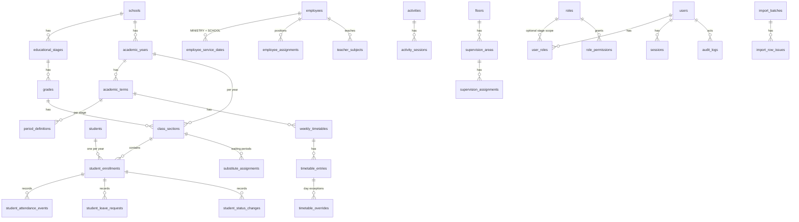

# مخطط العلاقات (مختصر)

## تغييرات المرحلة 4 (ترحيل `drizzle/0001_phase4_directory.sql`)
- `users.version` و`class_sections.version/updated_at/updated_by_id` للقفل التفاؤلي.
- `employees.work_location`: المرحلة أو موقع العمل (دليل المستخدمات والحراس).
- صلاحية جديدة `sections.write` (مقيّدة بالمرحلة): المديرة، وكيلة الشؤون التعليمية، مسؤولة الدليل.

## تغييرات المرحلة 5 (ترحيل `drizzle/0002_phase5_timetables.sql`)
- `weekly_timetables`: `version`، `source_timetable_id` (نُسخ من)، `created_by_id`، وفهرسان فريدان جزئيان: جدول **معتمد** واحد و**مسودة** واحدة لكل (فصل دراسي، مرحلة). المعتمد السابق يصبح `SUPERSEDED` ولا يُحذف.
- `period_definitions`: `version/updated_at/updated_by_id`.
- `activities`: `version/updated_at`.

## تغييرات المرحلة 6 (ترحيل `drizzle/0003_phase6_affairs_supervision.sql`)
- `student_attendance_events`: `version`، `approved_by_id`.
- `supervision_areas`: `version`.
- فهارس فريدة جزئية: `leave_active_uq` (استئذان نشط واحد للطالبة في اليوم)، `status_change_pending_uq` (طلب انقطاع/نقل واحد قيد الاعتماد لكل قيد).
